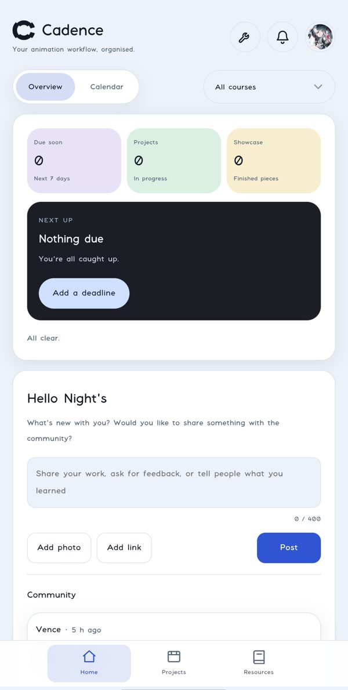
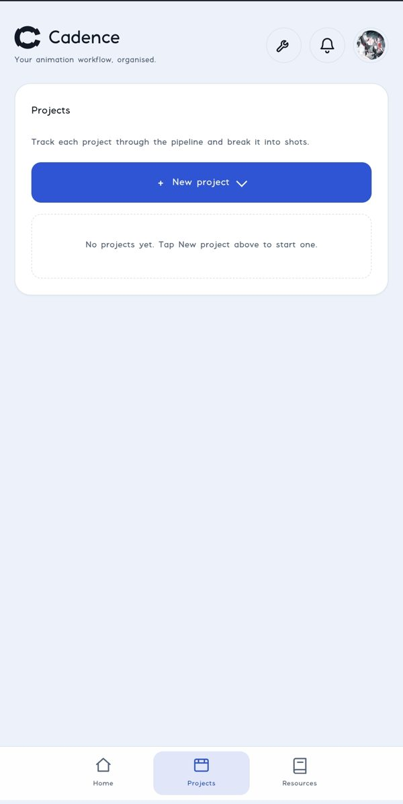

# Cadence

**Plan shots, track deadlines and show off your finished animation work.**

Cadence is a free web app for animation students. It saves on your device, works offline, and can be installed to your home screen. Sign in with Google if you want cloud backup and the community features.

**[Open the app](https://urnedksueh.github.io/Cadence/)**

| Home | Projects | Resources |
| :--: | :--: | :--: |
|  |  |  |

## Features

**Plan and track**
- Deadlines with an overview and a calendar, plus export to your own calendar (.ics)
- Projects with pipeline stages, a checklist and shots

**Animation tools**
- Frame calculator, render planner, resolution helper, focus timer and grade calculator

**Show and share**
- Showcase for your finished work, with share links
- Community feed with likes and comments, friends, and notifications
- Resources library with search and saved favourites

**App**
- Works offline and installs like a native app
- Light and dark theme
- Backup: export and import your data
- Use it without an account, or sign in with Google

## Getting started

Just open the [live app](https://urnedksueh.github.io/Cadence/) and tap **Continue without an account**, or **Sign in with Google**.

To run it on your computer, serve the folder with any static server:

```bash
git clone https://github.com/<your-username>/Cadence.git
cd Cadence
python3 -m http.server 8080
```

Then open `http://localhost:8080`. Opening `index.html` directly from disk won't work.

## Built with

- Plain HTML, CSS and JavaScript (no build step)
- Firebase Authentication (Google sign-in) and Cloud Firestore
- GitHub Pages for hosting

## Set up your own copy

1. Fork or clone this repo.
2. Create a free Firebase project and add a web app.
3. Paste your Firebase config into `cloud.js`.
4. Enable Google sign-in and create a Firestore database.
5. Add your Firestore security rules so people can only access their own data.
6. Turn on GitHub Pages (Settings → Pages → `main` / root).
7. Add `<your-username>.github.io` under Authentication → Settings → Authorized domains.

### Making an admin

Admins can post announcements and manage resources from their Profile page.

1. Sign in to the app once.
2. In Firebase, copy your User UID from Authentication → Users.
3. In Firestore, create a top-level collection called `admins` (lowercase).
4. Add a document whose ID is your UID, with any field (for example `admin: true`).
5. Hard refresh the app.

## Updating

Upload the changed files to the repo, commit, wait a minute or two, then hard refresh. If you change files, bump the cache name in `sw.js` (for example `cadence-v56`) so installed copies update.

## Security

The Firebase web config in `cloud.js` is public by design. It identifies the project but doesn't give access. Your data is protected by Firestore rules and sign-in. GitHub may flag the API key as a leak, which is a false positive for Firebase web keys. Never commit a service account `.json` key or any passwords.

## License

No license yet. All rights reserved by the author.
