<div align="center">



# Cadence

**Plan shots, track deadlines and show off your finished animation work.**

A free, installable web app for animation students. Works offline, saves on your device, and optionally syncs with your Google account.

[**Open the app →**](https://urnedksueh.github.io/Cadence/)


</div>

---

## Table of contents

- [About](#about)
- [Features](#features)
- [Screenshots](#screenshots)
- [Getting started](#getting-started)
- [Project structure](#project-structure)
- [Set up your own copy](#set-up-your-own-copy)
- [Admin tools](#admin-tools)
- [Updating the site](#updating-the-site)
- [Security and privacy](#security-and-privacy)
- [Troubleshooting](#troubleshooting)
- [Roadmap](#roadmap)
- [License](#license)

## About

Animation courses mean juggling deadlines, shot lists, render times and feedback across many projects. **Cadence** puts all of that in one lightweight app that runs in the browser and installs to your home screen like a native app.

It is built with plain HTML, CSS and JavaScript. There is no build step and no framework. Everything saves locally first, so it works without an account. Signing in with Google adds cloud backup and the community features.

## Features

**Plan and track**
- **Deadlines**: add, edit and complete deadlines, filter by course, and see what is due next on the Home overview.
- **Calendar**: month view of your deadlines, with export to your own calendar as an `.ics` file.
- **Projects**: move each project through pipeline stages (starting at Script), tick off a per-project checklist, break it into shots, add assessments, add notes on what you learned and instructor feedback, and keep a target grade.

**Animation tools** (open them from the wrench icon in the header)
- **Frame calculator**: work out frames, seconds and frame rate.
- **Render planner**: estimate render hours against your daily render time and a "must finish by" date.
- **Resolution helper**: presets and scale-to-width calculations.
- **Focus timer**: 25/5, 50/10 and 90/15 work-and-break presets.
- **Grade calculator**: see what you need to hit your target grade.

**Show and share**
- **Showcase**: add finished work with a thumbnail, video link (YouTube, Vimeo or Drive), tools used and the year made.
- **Share links and present mode**: publish a share page of your showcase, and stop sharing any time.

**Community** (requires Google sign-in)
- Post to a community feed (up to 400 characters, with optional photo or link), with likes and comments.
- Friend requests, a friends list, and blocking.
- Notifications from the bell icon, with a mark-all-read option.
- A shared **Resources** library of tutorials, references and tools, visible to signed-in students only, with search, category filters (such as Software), saved favourites, and links curated by admins.
- Profile with avatar colour, handle, bio, year level and role.

**App experience**
- Installable PWA with offline support (network first, cached fallback).
- In-app prompt when a new version is ready.
- Light and dark theme.
- Backup: export and import your data as a file.
- Continue without an account: nothing is required to start.

## Screenshots

| Home | Projects | Resources |
| :--: | :--: | :--: |
|  |  |  |

## Getting started

### Use it
1. Open the [live app](https://urnedksueh.github.io/Cadence/).
2. Tap **Continue without an account** to start right away, or **Sign in with Google** for sync and community features.
3. Optional: install it. On iPhone or iPad use Share → Add to Home Screen. On Android or desktop Chrome use the install prompt or menu.

### Run it locally
No build tools needed. Serve the folder with any static server:

```bash
git clone https://github.com/<your-username>/Cadence.git
cd Cadence
python3 -m http.server 8080
```

Then open `http://localhost:8080`. Google sign-in only works on a domain listed in Firebase **Authorized domains** (`localhost` is included by default). Opening `index.html` directly from disk will not work, because the app uses ES modules and a service worker.

## Project structure

```
Cadence/
├── index.html            App shell and all screens
├── style.css             Styling and themes
├── manifest.webmanifest  PWA manifest
├── sw.js                 Service worker (offline cache)
├── pwa.js                Install prompt and update banner
├── theme.js              Light and dark theme
├── gate.js               Sign-in gate and startup
├── storage.js            Local saving (all saves go through here)
├── script.js             Core logic: deadlines, projects, showcase
├── tabs.js               Tab navigation and profile page
├── tools.js              Frame, render, resolution, timer, grade tools
├── calendar.js           Calendar view and .ics export
├── cloud.js              Firebase config, sign-in, sync, announcements
├── share.js              Create and manage share links
├── shareview.js          Public share page
├── avatars.js            Avatar colours and display
├── social.js             Friends, requests and blocking
├── feed.js               Community posts, likes and comments
├── resources.js          Resources library
├── docs/                 README screenshots
└── logo.png, favicon.png, icon-192.png, icon-512.png
```

**Tech:** vanilla JavaScript (ES modules), Firebase Authentication (Google), Cloud Firestore, Firebase JS SDK 10.12.2 loaded from Google's CDN, GitHub Pages for hosting.

## Set up your own copy

Want to run Cadence for your own class or school? You will need a free Firebase project (the Spark plan is enough).

1. **Fork or clone** this repository.
2. **Create a Firebase project** at [console.firebase.google.com](https://console.firebase.google.com) and add a **Web app**.
3. **Paste your config** into the `firebaseConfig` object at the top of `cloud.js`.
4. **Enable sign-in:** Authentication → Sign-in method → Google → Enable, and set a support email.
5. **Create the database:** Firestore Database → Create database.
6. **Publish Firestore rules** that:
   - let signed-in users read and write only their own data,
   - let signed-in users read `announcements` and `resources`,
   - allow writes to `announcements` and `resources` only for users listed in the `admins` collection,
   - never allow `admins` to be written from the client.
7. **Turn on GitHub Pages:** Settings → Pages → Deploy from a branch → `main` / `(root)`.
8. **Authorize your domain:** Authentication → Settings → Authorized domains → add `<your-username>.github.io` (domain only, no `/Cadence` and no `https://`).

Firestore collections used by the app: `users`, `admins`, `announcements`, `resources`, `posts` (with `likes` and `comments`), `shares`, `friendRequests`, `friendships` and `blocks`.

## Admin tools

Admins see **Admin: announcements** and **Admin: resources** sections on their Profile page.

To make someone an admin:

1. Have them sign in to Cadence once.
2. In Firebase, open **Authentication → Users** and copy their **User UID**.
3. In **Firestore Database**, at the root, create a collection named `admins` (all lowercase).
4. Add a document whose **Document ID** is that UID, with any field, for example `admin: true` (boolean).
5. Hard refresh the app. The admin sections should appear.

Announcements appear as a dismissible banner on the Home tab (the three newest are shown).

## Updating the site

1. Unzip the new release on your device.
2. In your GitHub repo choose **Add file → Upload files** and upload the changed files themselves (not the zip, not a folder).
3. Commit, wait one to two minutes, then hard refresh.

When you change files, bump the `CACHE` name in `sw.js` (for example `cadence-v56`) so installed copies pick up the new version. Users will see a "new version is ready" prompt.

Do not commit `firestore.rules` copies with real secrets, setup notes with personal IDs, or any service account `.json` file.

## Security and privacy

- **The Firebase web config in `cloud.js` is public by design.** It identifies the project but does not grant access. Your data is protected by **Firestore security rules** and **Google sign-in**. GitHub's secret scanning may flag the API key; this is a known false positive for Firebase web keys.
- **Never commit** a service account key (a `.json` file containing `private_key`), `.env` files or passwords.
- **Recommended:** in Google Cloud Console → APIs & Services → Credentials → Browser key, restrict the key to HTTP referrers: `https://<your-username>.github.io/*` and `https://<your-project-id>.firebaseapp.com/*`.
- **Data storage:** without an account, data stays in your browser's local storage on your device. With an account, backups and community content are stored in Cloud Firestore under your Google account ID.
- Admin rights are granted only through the `admins` collection, which clients cannot write to.

## Troubleshooting

| Problem | Fix |
| --- | --- |
| Sign-in fails or the popup shows an error | Check your domain is in Authorized domains, Google sign-in is enabled, popups are allowed, and any API key restriction includes both your site and the `firebaseapp.com` domain |
| Admin section is missing | Check the `admins` document ID matches the UID exactly, the collection name is lowercase `admins`, then hard refresh |
| "Permission denied" when posting | Re-publish your Firestore rules |
| Still seeing the old version after an update | Hard refresh, try a private tab, or accept the "new version" prompt |
| 404 on the site | Wait a couple of minutes after enabling Pages and confirm Settings → Pages shows it as published |

## Roadmap

- [ ] Add a license
- [ ] Document the Firestore rules in the repository

## License

No license has been chosen yet. Until one is added, all rights are reserved by the author. To let others use or adapt Cadence, add a `LICENSE` file. [choosealicense.com](https://choosealicense.com/) can help you pick one.

---

<div align="center">

Made for animation students. Questions or ideas? Open an [issue](../../issues).

</div>
