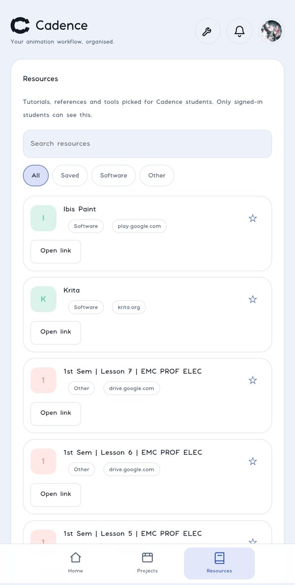

<div align="center">


# Cadence

**Plan shots, track deadlines, team up on projects and show off your finished animation work.**

Cadence is a free web app for animation students. It saves on your device, works offline, and can be installed to your home screen. Sign in with Google if you want cloud backup, team projects and the community features.

**[Open the app](https://urnedksueh.github.io/Cadence/)**

| Home | Projects | Resources |
| :--: | :--: | :--: |
|  |  |  |

</div>

## Features

**Plan and track**
- Deadlines with an overview and a calendar, plus export to your own calendar (.ics)
- Personal projects with pipeline stages, a checklist and shots
- Notifications for tasks assigned to you, due dates and announcements

**Team up (shared projects)**
- Anyone signed in can start a shared project from a template (animation pipeline, 3D character, motion graphics, short film) and becomes its owner
- Stages with an assignee, a due date, a status (To do, In progress, Review, Needs changes, Done), a note and up to 5 named links (v1, v2, final)
- A clear "Your turn" box and progress bar on every project
- Add people from your friends list, by handle, or with an invite code
- Team chat per project: General, Announcements and a thread for every stage
  - Profile pictures, @mentions with a name picker, and @everyone for owners and admins
  - Reactions, pinned messages, unread badges and automatic status lines such as "Mika set Animation to Review"
- Owners manage their own project: stages, people, invite codes, Announcements and pins. Admins can manage every project

**Animation tools**
- Frame calculator, render planner, resolution helper, focus timer and grade calculator

**Show and share**
- Showcase for your finished work, with share links
- Community feed with likes and comments, friends, and profiles
- Resources library with search and saved favourites

**App**
- Works offline and installs like a native app
- Light and dark theme
- Backup: export and import your data
- Use it without an account, or sign in with Google

## Getting started

Just open the [live app](https://urnedksueh.github.io/Cadence/) and tap **Continue without an account**, or **Sign in with Google**.

Shared projects and chat need a Google sign-in. To join a project, open the **Projects** tab, tap **Join with a code** and enter the code you were given.

To run it on your computer, serve the folder with any static server:

```bash
git clone https://github.com/<your-username>/Cadence.git
cd Cadence
python3 -m http.server 8080
```

Then open `http://localhost:8080`. Opening `index.html` directly from disk won't work.

## Built with

- Plain HTML, CSS and JavaScript (no build step)
- Firebase Authentication (Google sign-in) and Cloud Firestore
- GitHub Pages for hosting

## Set up your own copy

1. Fork or clone this repo.
2. Create a free Firebase project and add a web app.
3. Paste your Firebase config into `cloud.js`.
4. Enable Google sign-in and create a Firestore database.
5. In Firestore → Rules, paste your complete security rules and publish. They must cover profiles, friends, posts, shared projects, chat and invite codes, so people can only reach what they should. Keep the rules file out of this repo.
6. Turn on GitHub Pages (Settings → Pages → `main` / root).
7. Add `<your-username>.github.io` under Authentication → Settings → Authorized domains.

### Making an admin

Admins can post announcements, manage resources and see and manage every shared project.

1. Sign in to the app once.
2. In Firebase, copy your User UID from Authentication → Users.
3. In Firestore, create a top-level collection called `admins` (lowercase).
4. Add a document whose ID is your UID, with any field (for example `admin: true`).
5. Hard refresh the app.

### Who can do what in shared projects

| | Member | Owner (creator) | Admin |
| :-- | :--: | :--: | :--: |
| See the project and chat | ✓ | ✓ | ✓ (all projects) |
| Update stage status and chat | ✓ | ✓ | ✓ |
| Edit stages, people and dates | | ✓ | ✓ |
| Make invite codes | | ✓ | ✓ |
| Post in Announcements, @everyone, pin | | ✓ | ✓ |
| Delete the project | | ✓ | ✓ |

Students can own up to 5 projects. This limit is enforced in the app only.

## Free plan limits

Cadence is designed to stay inside Firebase's free Spark plan, which is plenty for a class.

- Chat loads the last 30 messages and listens only to the thread you have open
- Unread badges refresh when the app is reopened or refocused, not live
- Links only, no file uploads
- No push notifications while the app is closed, typing indicators or search across all messages

## Updating

Upload the changed files to the repo, commit, wait a minute or two, then hard refresh. If you change files, bump the cache name in `sw.js` so installed copies update. If a release changes the Firestore rules, publish the new rules first, then upload the files.

## Security

The Firebase web config in `cloud.js` is public by design. It identifies the project but doesn't give access. Your data is protected by Firestore rules and sign-in. GitHub may flag the API key as a leak, which is a false positive for Firebase web keys. Never commit a service account `.json` key or any passwords.

Invite codes are random and can't be listed, but anyone in a project can see and pass on its code. Owners can make a new code or turn it off at any time.

## License

No license yet. All rights reserved by the author.
